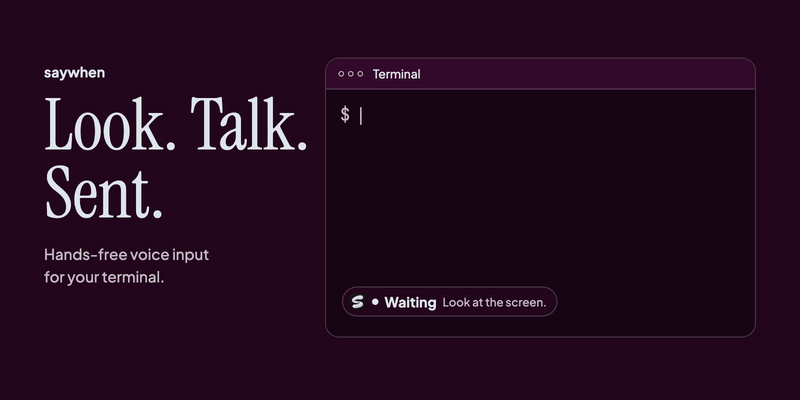
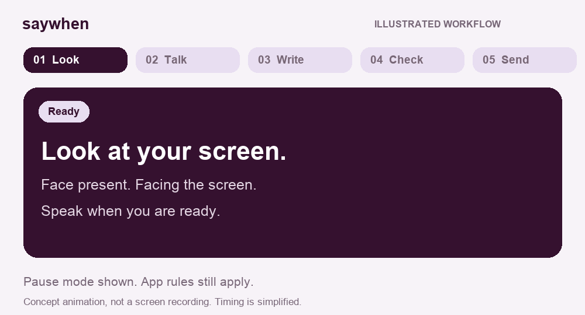
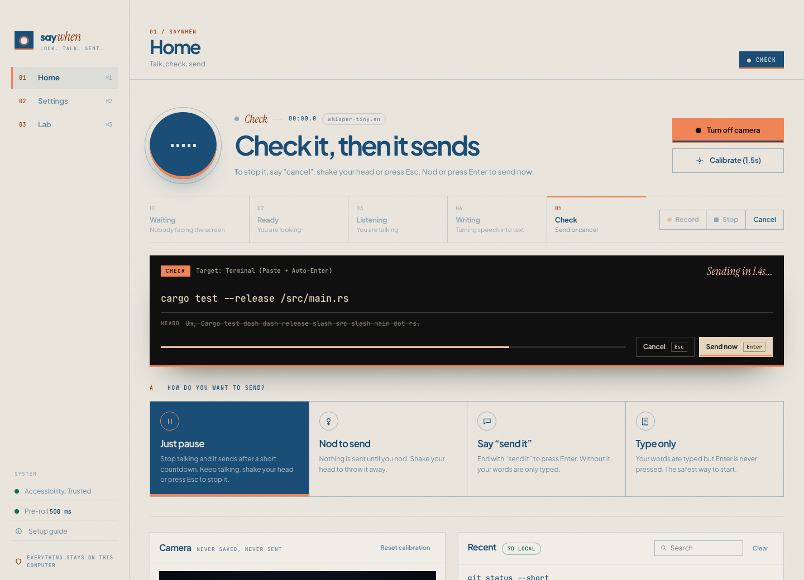
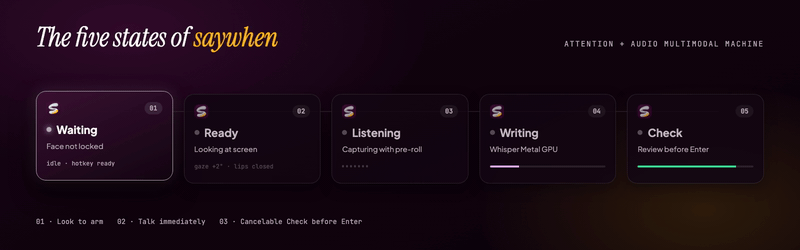
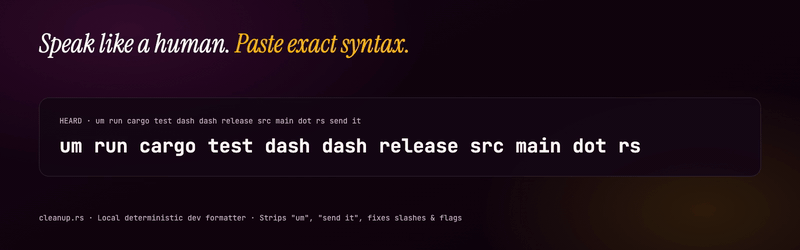
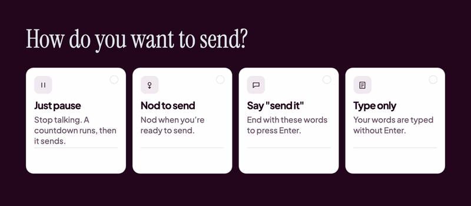
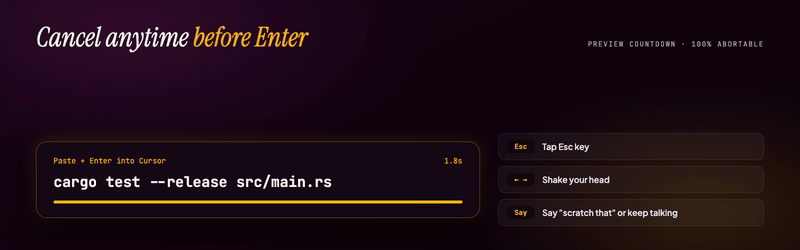
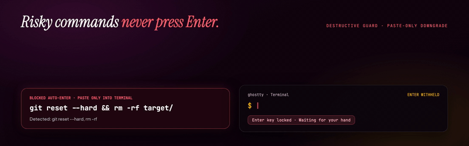
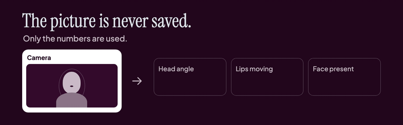

# saywhen

[](LICENSE)
[](https://github.com/kmsmohamedansar/saywhen/releases/latest)
[](https://github.com/kmsmohamedansar/saywhen/actions/workflows/ci.yml)


**Look at the screen. Say what you want. saywhen types it, and can press Enter.**

saywhen is a free, open source desktop app for Mac and Windows. It is for people who talk to a terminal or a coding assistant (Terminal, Cursor, VS Code, Claude Code, and others) and do not want to hold a hotkey.

Your voice and camera stay on your computer. You always get a short chance to cancel before anything is sent.

[Watch the demo](#watch-the-demo) · [How it works](#how-it-works) · [Install](#install) · [For Claude and Cursor](#for-coding-assistants) · [Docs](docs/README.md) · [Project page](https://ansarbuilds.dev/p/saywhen/)

**Beta.** You can build it and try it today. Packaged installers exist, and real-device checks for Windows, Intel Macs, and signed Mac builds are still open. See the [launch checklist](docs/LAUNCH_CHECKLIST.md).

---

## Watch the demo

https://github.com/user-attachments/assets/2ac61c5f-9fce-4fb5-b146-e4e08f66a520

*The 60-second launch film. Press play; it has voice and sound. The film is an animation that shows the idea. It is not a live screen recording, and its timing is not a speed measurement.*

Player not showing? [Watch it on the project page](https://ansarbuilds.dev/p/saywhen/) or [download the MP4](https://github.com/kmsmohamedansar/saywhen/releases/download/v0.2.0/saywhen-demo.mp4). There is also a [12-second teaser](https://github.com/kmsmohamedansar/saywhen/releases/download/v0.2.0/saywhen-announce.mp4).

<details>
<summary><strong>Open the animated step-by-step walkthrough</strong></summary>



*Illustrated pause-mode walkthrough, simplified timing, not a live screen recording.* [View the still image](docs/visuals/workflow-still.png).

</details>

<details>
<summary><strong>See the app interface</strong></summary>



*App interface captured in browser demo mode. This is separate from the film and the walkthrough above.*

</details>

The short animations on this page are illustrations drawn from the app's interface. They are not screen recordings, and their timing is not a measurement.

---

## How it works



1. **Look** at your screen. saywhen uses your webcam to notice you are facing it. It only keeps a few numbers, such as which way your head is turned. Pictures are never saved or sent anywhere.
2. **Talk.** When your lips move and the microphone hears your voice, it starts listening.
3. **Stop talking.** saywhen writes down what you said, tidies developer speech (`dash dash release` becomes `--release`), and shows you the result for a moment.
4. **It sends.** The text is typed into the app you are using, and Enter is pressed when that is allowed. Changed your mind? Say "cancel", shake your head, or press **Esc**.



The longer, friendly explanation is **[How saywhen works](docs/HOW_IT_WORKS.md)**.

A manual shortcut always exists: **Option + Space** on Mac, **Alt + Space** on Windows. That starts and stops listening with no camera.

---

## Pick how you send

You choose this once on the Home screen. You can change it any time.



| Send style | What you do | Good for |
| --- | --- | --- |
| **Just pause** (default) | Stop talking. A short countdown runs, then it sends. | Fast, hands-free work |
| **Nod to send** | Nothing is sent until you nod. | When you want to be sure |
| **Say "send it"** | End with "send it" to press Enter. Otherwise the text is only typed. | Mixing notes and commands |
| **Type only** | Your words are typed. Enter is never pressed. | The first time you try saywhen |

You can always stop a send:

- **Shake your head** or press **Esc** to cancel.
- **Nod** or press **Enter** to send right away.
- **Start talking again** during the countdown to cancel it. You can turn this off in Settings.



### Handy things to say

| Say this | What happens |
| --- | --- |
| "...send it" | Sends and presses Enter |
| "...paste only" | Types the text without pressing Enter, just this once |
| "scratch that" | Throws away what you just said |
| "cancel that" / "never mind" | Throws away the whole thing |

### Safety built in



- Enter is pressed only in apps you trust. Terminals and code editors are trusted by default. In chat, email, and browsers, saywhen only types.
- Risky commands such as `rm -rf`, `git reset --hard`, and `git push --force` are never sent automatically. They are typed, with a warning, and you press Enter yourself.
- If you switch apps during the countdown, saywhen stops. It does not type into the new app.

---

## Is it private?

Yes. That is the design.



- **Camera.** Pictures stay in memory for a split second, then they are thrown away. Only numbers are used: head angle, and how open your mouth is. Nothing is saved or sent.
- **Microphone.** Your voice is turned into text on your computer. The audio is discarded after that, unless you turn on local tuning recordings in Settings.
- **History.** The last 7 days of text stay on your computer so you can search and copy them. Turn this off in Settings, or clear it with one click.
- **Internet.** After the speech model is downloaded, saywhen works offline. Optional AI clean-up is off by default. If you turn it on, you choose where the text goes. A local Ollama is the default.

---

## Install

Pick one path.

### Point Claude or Cursor at this repo

Open this folder in Claude or Cursor and paste:

```text
Set up saywhen on my computer.

This repository is already open. Follow INSTALL_WITH_AI.md from the top.
Do not clone it again.
Ask me before you install anything. Explain each step in one plain sentence.
On a Mac, do not start the app yourself. Tell me the command to run in the Terminal app.
When the window is open, walk me through First launch in the README, one step at a time.
```

You only have the link, and the folder is not open yet? Paste this instead:

```text
Clone https://github.com/kmsmohamedansar/saywhen and open that folder.
Then follow INSTALL_WITH_AI.md from the top.
Ask me before you install anything. Explain each step in one plain sentence.
On a Mac, do not start the app yourself. Tell me the command to run in the Terminal app.
```

The full checklist is [INSTALL_WITH_AI.md](INSTALL_WITH_AI.md). The rules your assistant must keep are in [For coding assistants](#for-coding-assistants).

### Download the app

Get the latest installer from the **[Releases page](https://github.com/kmsmohamedansar/saywhen/releases/latest)**:

- **Mac:** the `.dmg` file (`aarch64` is for Apple Silicon, `x64` is for Intel Macs when that build is included). Open it and drag saywhen into Applications.
- **Windows:** the `-setup.exe` file. Run it.

If your Mac says saywhen "is damaged" or "cannot be opened", that build was not signed by Apple yet. Run this once in Terminal, then open the app again:

```bash
xattr -cr /Applications/saywhen.app
```

On Windows, if SmartScreen appears, click **More info**, then **Run anyway**.

### Build it yourself

You need three free tools first:

- **Node.js 20 or newer:** [nodejs.org](https://nodejs.org)
- **Rust:** [rustup.rs](https://rustup.rs)
- **CMake:** on a Mac, `brew install cmake`. On Windows, install it from [cmake.org](https://cmake.org/download/) and tick "Add CMake to the system PATH".

Windows also needs [Visual Studio Build Tools 2022](https://visualstudio.microsoft.com/downloads/) with the "Desktop development with C++" workload.

Then, in a terminal:

```bash
git clone https://github.com/kmsmohamedansar/saywhen.git
cd saywhen
npm ci
npx tauri dev
```

The first run downloads the camera model (about 4 MB) and can take 5 to 15 minutes while it compiles. Later starts are much faster. On a Mac, run that last command in the **Terminal** app. A background shell from an assistant usually cannot get camera permission. The development app is named **saywhen-dev**.

### First launch

Do these once, in order:

1. **Download a speech model.** Open **Settings** (second item in the sidebar), find **Speech model**, and click **Download**. Tiny is about 75 MB and the fastest. Base is more accurate.
2. **Allow the microphone and camera** when your computer asks.
3. **Allow Accessibility (Mac only).** This lets saywhen type into other apps. Click **Setup guide** in the sidebar, then the orange badge next to Accessibility. Turn on **saywhen** for the installed app, or **saywhen-dev** if you built it yourself. Remove old saywhen entries first if macOS is confused.
4. **Pick a send style** on Home. For a first try, pick **Type only**, so Enter is never pressed by accident.
5. **Turn on the camera** on Home. Look at the screen with your mouth closed and click **Calibrate**.
6. Open a terminal, look at it, and say "git status".

---

## For coding assistants

A person opened this repository in Claude, Cursor, or a similar tool. Read this before you install, run, or change anything.

**They want it running.** Follow [INSTALL_WITH_AI.md](INSTALL_WITH_AI.md) from the top. That file is the procedure. Do not invent a shorter one.

- If you can read this file, the code is already here. Do not clone a second copy. Run commands from this folder.
- Ask before installing anything system-wide: Homebrew, Rust, Node.js, CMake, or Visual Studio Build Tools. Say what it is, why saywhen needs it, and roughly how big it is.
- Explain each step in one plain sentence before you run it. Say "the tool that builds the app" rather than "the Rust toolchain".
- Never type their password. If a prompt will appear, tell them and wait.
- If a step fails, stop. Show the last few lines of the error. Do not skip it.
- Do not change System Settings yourself. Tell them which switch to click.
- On a Mac, do not run `npx tauri dev` from your own background shell. macOS gives the camera and microphone to the program that started saywhen, and a background shell is usually blocked (`NotAllowedError`). Ask them to open the **Terminal** app and run the command there. The dev app is named **saywhen-dev**.
- When the window opens, walk them through [First launch](#first-launch), one step at a time, and wait for each answer.
- You are done when a speech model is downloaded, the camera and microphone are allowed, and a short phrase such as "git status" shows up in a terminal they chose.

**They want you to change the code.** Read [AGENTS.md](AGENTS.md) (same guidance as [CLAUDE.md](CLAUDE.md)), [docs/ARCHITECTURE.md](docs/ARCHITECTURE.md), and [docs/ROADMAP.md](docs/ROADMAP.md) first. Keep the app local-first and private. Every automatic send must stay cancelable. If the camera, microphone, model, or typing fails, say so. Claims about speed or accuracy need a measurement. Do not commit model files (`*.bin`, `*.gguf`, `*.onnx`), recordings, or `settings.local.json`.

**They want to understand it.** Explain [How it works](#how-it-works) in plain language. The longer version is [docs/HOW_IT_WORKS.md](docs/HOW_IT_WORKS.md).

---

## When something goes wrong

| Problem | Try this |
| --- | --- |
| Nothing gets typed | On a Mac, open **System Settings > Privacy & Security > Accessibility** and allow saywhen, or saywhen-dev if you built it yourself. |
| It never starts listening | Turn the camera on and click **Calibrate**. Or use **Option + Space** / **Alt + Space**. |
| I want to talk while looking away | Turn on **Settings > Wake word when you look away** and start with "Eevee", as in "Eevee, run the tests". |
| My webcam sits beside the screen | Look at the screen you talk to, keep your mouth closed, and click **Calibrate**. saywhen learns that the camera is off to the side. It works up to about a 65 to 70 degree head turn. |
| It starts when I am not talking to it | Turn up **Settings > Noise filter**, or pick **Nod to send**. |
| My first or last word is cut off | Speak a little more slowly at the end, then [open an issue](https://github.com/kmsmohamedansar/saywhen/issues/new/choose) so it can be tuned. |
| It typed but did not press Enter | The app may be missing from **Settings > Apps where Enter can be pressed**, or the command looked risky. |
| Something else | Open **Problems** on Home. Copy the message and [open an issue](https://github.com/kmsmohamedansar/saywhen/issues/new/choose). |

---

## Learn more

**[Browse the documentation](docs/README.md)** for install help, the plain-language guide, and the engineering notes.

- **[How saywhen works](docs/HOW_IT_WORKS.md):** camera, listening, and sending, without the engineering words.
- **[How we built it](docs/HOW_WE_BUILT_IT.md):** the story, stage by stage, with the measurements.
- **[Vision](docs/VISION.md)**, **[Architecture](docs/ARCHITECTURE.md)**, **[Roadmap](docs/ROADMAP.md)**, **[Risks](docs/RISKS.md)**, **[Prior art](docs/PRIOR_ART.md):** the deeper documents.
- **[Contributing](CONTRIBUTING.md)** and **[Security](SECURITY.md).**

To update a copy you built yourself:

```bash
cd saywhen && git pull && npm ci && npx tauri dev
```

---

## For developers

saywhen is a [Tauri v2](https://tauri.app) app. The engine is Rust. The window is TypeScript, HTML, and CSS.

```bash
npm run build
cargo test --locked --manifest-path src-tauri/Cargo.toml
cargo run --manifest-path src-tauri/Cargo.toml --bin replay -- recordings
./scripts/capture-screenshots.sh
```

On a Mac, if `cargo` is not on your PATH:

```bash
export PATH="/opt/homebrew/bin:$HOME/.cargo/bin:$PATH"
```

### Measured on Apple Silicon

| Part | What we measured | Result |
| --- | --- | --- |
| Face tracking (MediaPipe) | Time per camera frame | 12 to 15 ms |
| "Facing the screen" check | Telling facing from turned away | 100% on our test sessions |
| "Mouth still" check | Ignoring a closed or still mouth | 96.2% rejected correctly |
| Start and end of speech | 56 test clips (generated speech plus simulated camera traces, not live users) | 0% false starts (was 36.4%), 0% cut-offs (was 52.9%) |
| Developer word clean-up | 34 spoken commands | 34 of 34 exact (was 44.1%) |
| Speech to text (Whisper tiny.en, GPU) | 1.5 s of audio | 87 to 473 ms |
| Finding the front app (macOS) | Median of 20 calls | 1 to 2 microseconds |

### Where to look

| Path | What it is |
| --- | --- |
| [src-tauri/src/audio.rs](src-tauri/src/audio.rs) | Microphone, 500 ms pre-roll, voice detection, the 5-state machine, settings |
| [src-tauri/src/turn_taking.rs](src-tauri/src/turn_taking.rs) | When to start, when you are done, send modes, speech-cancel |
| [src-tauri/src/bin/replay.rs](src-tauri/src/bin/replay.rs) | Offline replay benchmark |
| [src-tauri/src/transcribe.rs](src-tauri/src/transcribe.rs) | Whisper on the GPU, model download, "send it" detection |
| [src-tauri/src/cleanup.rs](src-tauri/src/cleanup.rs) | Developer word clean-up, "scratch that", custom words, risky-command guard |
| [src-tauri/src/inject.rs](src-tauri/src/inject.rs) | Typing into other apps, per-app rules, front-app detection |
| [src/main.ts](src/main.ts) | Camera, head gestures, main window |
| [INSTALL_WITH_AI.md](INSTALL_WITH_AI.md) | The setup procedure assistants must follow |

Contributions are welcome. Start with [CONTRIBUTING.md](CONTRIBUTING.md). To report a security or privacy problem, use [SECURITY.md](SECURITY.md), not a public issue.

## License

MIT. See [LICENSE](LICENSE).

Built by [Mohamed Ansar](https://ansarbuilds.dev). The story and the film are on the [project page](https://ansarbuilds.dev/p/saywhen/).
