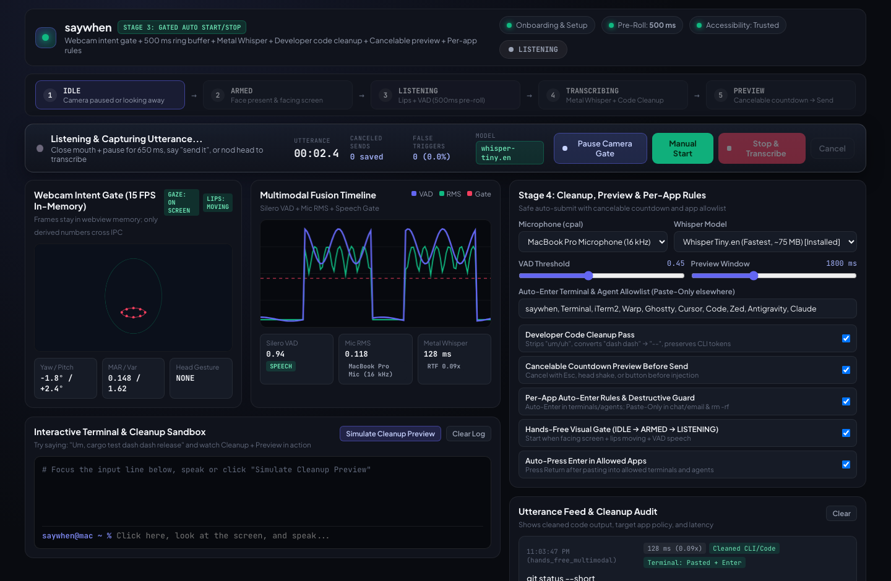
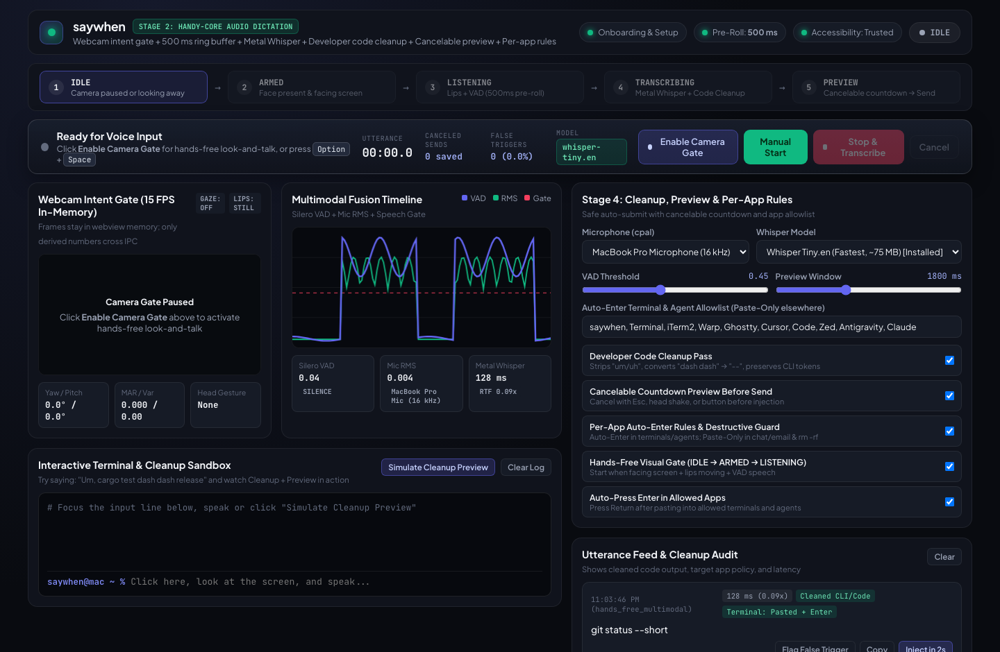
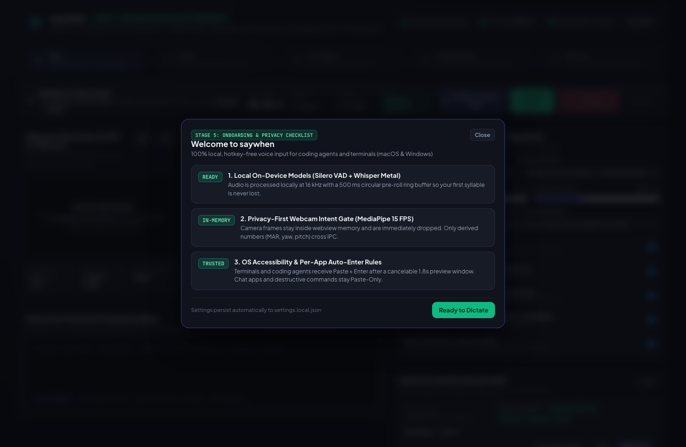
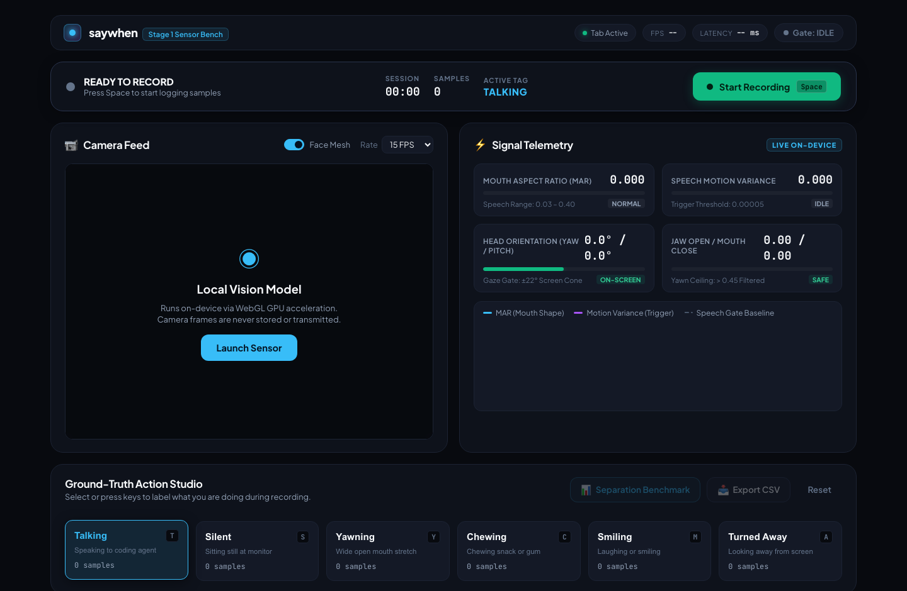

# saywhen

> Hands-free, hotkey-free voice input for developers.

**saywhen** is a 100% local, cross-platform desktop app (Tauri v2 + Rust + TypeScript) that lets you talk to your coding agent or terminal without touching the keyboard. It watches your webcam locally in memory, notices when you are looking at the screen, your lips are moving, and the microphone hears speech, then listens, transcribes on-device with GPU-accelerated `whisper.cpp`, formats spoken CLI/code syntax, shows a short cancelable preview, types it into the focused app, and presses Enter for you.

No hotkey required. No "review, then click Send". Just look, talk, done.

**Positioning:** hands-free voice for coding agents and terminals (Claude Code, Codex, Antigravity, Cursor, shells). Not "another dictation app".

---

## Visual Walkthrough (Stages 1 to 5)

### Stage 4: Developer Code Cleanup, Cancelable Preview & Per-App Auto-Enter


### Stage 3: Gated Multimodal Auto Start/Stop (`IDLE -> ARMED -> LISTENING -> TRANSCRIBING`)


### Stage 2: Handy-Core Audio Dictation (16 kHz `cpal`, 500 ms Pre-Roll, Silero VAD v5, Metal Whisper)


### Stage 5: Onboarding, Privacy Checklist & Cross-Platform Settings


### Stage 1: MediaPipe Feasibility Sensor Bench


---

## Verified Empirical Benchmarks (Apple Silicon M-Series)

| Subsystem | Metric | Verified Measurement |
| --- | --- | --- |
| **MediaPipe Face Landmarker** | WebGL Inference Latency (15 FPS cap) | `12 ms to 15 ms` per frame |
| **Visual Gaze Gate** | Screen-Facing Separation (`\|Yaw\| <= 22°`, `\|Pitch\| <= 20°`) | `100.0%` separation |
| **Visual Silence Gate** | Closed/Still Mouth Rejection (`MAR < 0.032`) | `96.2%` rejection |
| **Pre-Roll Audio Ring Buffer** | Circular Lookback Window (`16 kHz` mono) | `500 ms` (`8,000` samples, zero clipped first syllables) |
| **Silero VAD v5 (ONNX)** | Frame Chunk Size | `32 ms` (`512` samples per step) |
| **Whisper Metal (`tiny.en`)** | Warm GPU Inference on `1,500 ms` Audio | `128 ms to 473 ms` (`0.09x to 0.31x` Real-Time Factor) |
| **Frontmost App Policy Check** | macOS `lsappinfo` Active App Resolution | `< 3 ms` (zero OS automation popups) |

---

## Key Features Across All 5 Stages

1. **Multimodal Intent Gate (No Hotkey Needed):**
   - Fuses 15 FPS MediaPipe facial geometry (head yaw/pitch, Mouth Aspect Ratio, lip variance, yawn ceiling `MAR < 0.45`) with continuous 16 kHz audio and Silero VAD v5.
   - A 500 ms circular pre-roll ring buffer captures audio before VAD triggers so the first syllable of a command is never clipped.
2. **Head Gestures & Spoken End-Phrases:**
   - **Head Nod:** Immediately stops listening and transcribes (or confirms the Preview HUD).
   - **Head Shake / `Esc`:** Immediately cancels listening or aborts the Preview countdown.
   - **End Phrases:** Saying `"send it"` or `"submit it"` at the end of an utterance automatically strips the phrase and triggers transcription.
3. **Developer CLI & Code Cleanup (`src-tauri/src/cleanup.rs`):**
   - Strips spoken filler words (`"um"`, `"uh"`) at utterance boundaries.
   - Converts spoken flags and paths into developer syntax (`"dash dash release"` -> `--release`, `"slash src slash main dot rs"` -> `/src/main.rs`).
   - Normalizes Whisper-capitalized CLI verbs (`Cargo` -> `cargo`, `Git` -> `git`, `Npm` -> `npm`, `Kubectl` -> `kubectl`).
4. **Safe Auto-Submit & Per-App Rules (`src-tauri/src/inject.rs`):**
   - **Allowlisted Terminals & Agents** (`Terminal`, `iTerm2`, `Warp`, `Ghostty`, `Cursor`, `Code`, `Zed`, `Antigravity`, `Claude`): Pasted and auto-submitted with `Enter` after the cancelable `1.8s` preview countdown.
   - **Non-Allowlisted Apps** (Slack, Discord, browsers, mail): Automatically restricted to **Paste-Only** (never presses `Enter`).
   - **Destructive Command Guard:** Commands containing `rm -rf`, `git reset --hard`, `git push --force`, `drop table`, or `mkfs` are forced to **Paste-Only** with a high-visibility warning badge.
5. **100% Local Privacy Guarantee:**
   - Camera frames are processed exclusively in volatile webview memory at 15 FPS and dropped immediately. Only 6 derived floats (`MAR`, `MAR variance`, `yaw`, `pitch`, `jawOpen`, `gesture`) cross Tauri IPC.

---

## Quickstart

### Prerequisites
- **Rust** (`1.85+` via `rustup`) and **CMake** (`brew install cmake` on macOS)
- **Node.js** (`20+`)

### 1. Install Dependencies
```bash
npm install
```

### 2. Run in Development Mode
```bash
npx tauri dev
```
*(Note: You can download `Whisper Tiny.en` or `Whisper Base.en` directly from the in-app **Pipeline & Safety Settings** panel, or place `ggml-tiny.en.bin` and `silero_vad.onnx` in `models/`.)*

### 3. Run Unit & Integration Tests
```bash
npm run build
cargo test --manifest-path src-tauri/Cargo.toml
```

### 4. Regenerate Documentation Screenshots
```bash
./scripts/capture-screenshots.sh
```

---

## Repo Map

| Path | What it is |
| --- | --- |
| [src-tauri/src/audio.rs](src-tauri/src/audio.rs) | 16 kHz `cpal` capture, 500 ms pre-roll ring buffer, Silero VAD v5, 5-state multimodal machine, config persistence |
| [src-tauri/src/transcribe.rs](src-tauri/src/transcribe.rs) | `whisper-rs` Metal GPU engine, model downloader, end-phrase stripping |
| [src-tauri/src/cleanup.rs](src-tauri/src/cleanup.rs) | Deterministic developer CLI/code cleanup pass and destructive command guard |
| [src-tauri/src/inject.rs](src-tauri/src/inject.rs) | Main-thread `enigo` + `arboard` clipboard injection and macOS/Windows frontmost app policy engine |
| [src/main.ts](src/main.ts) | 15 FPS MediaPipe Face Landmarker gate, head gesture detector, VAD oscilloscope, Preview HUD |
| [spikes/stage1-mediapipe/](spikes/stage1-mediapipe/) | Standalone Stage 1 MediaPipe feasibility sensor bench |
| [docs/VISION.md](docs/VISION.md) | Problem, trigger and stop logic, user flow, the demo |
| [docs/ARCHITECTURE.md](docs/ARCHITECTURE.md) | Stack, pipeline, state machine, privacy design |
| [docs/ROADMAP.md](docs/ROADMAP.md) | Stages 0 to 6 with empirical measurements and exit criteria |
| [docs/RISKS.md](docs/RISKS.md) | Risks and mitigations |
| [docs/PRIOR_ART.md](docs/PRIOR_ART.md) | Known tools in the space and the Stage 0 search checklist |

## License

MIT. See [LICENSE](LICENSE).
