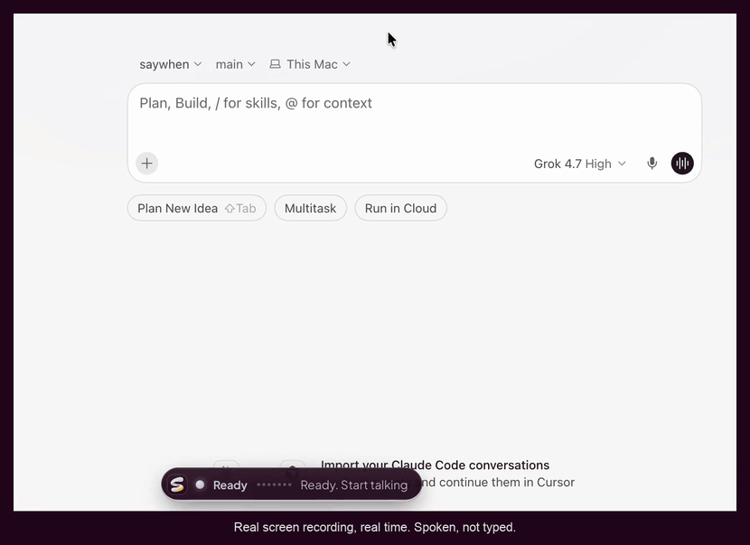

# saywhen

[](LICENSE)
[](https://github.com/ansarbuilds/saywhen/releases/tag/v0.2.0)
[](https://github.com/ansarbuilds/saywhen/actions/workflows/ci.yml)


**Look at the screen. Say the command. saywhen types it, and can press Enter.**

No hotkey to hold. Your voice and camera stay on this computer. You see the words before they go anywhere.

[Watch it](#watch-it) · [How it works](#how-it-works) · [Safe to try](#safe-to-try) · [Install](#install) · [For Claude and Cursor](#for-coding-assistants) · [Who it's for](#who-its-for) · [Project page](https://ansarbuilds.dev/p/saywhen/)

**Beta**, for Mac and Windows. Real-device checks for signed Mac builds, Intel Macs, and Windows are still open. [Launch checklist](docs/LAUNCH_CHECKLIST.md).

---

## Watch it

https://github.com/user-attachments/assets/2ac61c5f-9fce-4fb5-b146-e4e08f66a520

*Sixty seconds, with voice and sound.*

No player? [Watch it on the project page](https://ansarbuilds.dev/p/saywhen/) or [download the MP4](https://github.com/ansarbuilds/saywhen/releases/download/v0.2.0/saywhen-demo.mp4). There is also a [12-second teaser](https://github.com/ansarbuilds/saywhen/releases/download/v0.2.0/saywhen-announce.mp4).

### And the real thing



*A real screen recording, in real time, with no sound. A spoken request is typed into Cursor and sent. One run on an Apple Silicon Mac, not a benchmark.*

---

## How it works


The camera and the microphone have to agree. A camera cannot tell chewing from talking. A microphone cannot tell who you are talking to.

1. **Look.** saywhen notices you are facing the screen. It keeps a few numbers, such as head angle. The picture is thrown away.
2. **Talk.** Lips moving, and a voice on the microphone. Listening starts. The last half second is already kept, so the first word is not lost.
3. **Read it.** `dash dash release` becomes `--release`. A preview shows the result.
4. **Send, or don't.** Esc, a head shake, or talking again throws it away. If you let it go, the text is typed into the app in front. Enter is pressed only when that is allowed.


*The Home screen, in the app's demo mode.*

A manual shortcut always exists: **Option + Space** on Mac, **Alt + Space** on Windows. That starts and stops listening with no camera.

The longer version is **[How saywhen works](docs/HOW_IT_WORKS.md)**.

---

## Pick how you send


| Send style | What you do | Good for |
| --- | --- | --- |
| **Just pause** (default) | Stop talking. A short countdown runs, then it sends. | Fast, hands-free work |
| **Nod to send** | Nothing is sent until you nod. | When you want to be sure |
| **Say "send it"** | End with "send it" to press Enter. Otherwise the text is only typed. | Mixing notes and commands |
| **Type only** | Your words are typed. Enter is never pressed. | The first time you try saywhen |


Stop it any time: shake your head, press **Esc**, or start talking again during the countdown. Nod, or press **Enter**, to send right away.

| Say this | What happens |
| --- | --- |
| "...send it" | Sends and presses Enter |
| "...paste only" | Types the text without pressing Enter, just this once |
| "scratch that" | Throws away what you just said |
| "cancel that" / "never mind" | Throws away the whole thing |

---

## Safe to try


- Enter is pressed only in apps you trust. Terminals and code editors are trusted by default. In chat, email, and browsers, saywhen only types.
- Risky commands such as `rm -rf`, `git reset --hard`, and `git push --force` are typed, with a warning. You press Enter yourself. The check is a heuristic, not a guarantee.
- If you switch apps during the countdown, saywhen stops. It does not type into the new app.


- **Camera.** Pictures stay in memory for a split second, then they are thrown away. Nothing is saved or sent.
- **Microphone.** Your voice becomes text on this computer. The audio is discarded after that, unless you turn on local tuning recordings.
- **History.** The last 7 days of text stay on your computer. Turn this off, or clear it with one click.
- **Internet.** After the speech model is downloaded, saywhen works offline. Optional cloud clean-up stays off until you turn it on. A local Ollama is the default.
- **The install warning.** This beta is not signed by Apple or Microsoft yet. The extra question is about that missing signature. [Install](#install) has the one step. You can also build saywhen from this repository and skip the downloaded app.

---

## Install

### Point Claude or Cursor at this repo

Open this folder and paste:

```text
Set up saywhen on my computer.

This repository is already open. Follow INSTALL_WITH_AI.md from the top.
Do not clone it again.
Ask me before you install anything. Explain each step in one plain sentence.
On a Mac, do not start the app yourself. Tell me the command to run in the Terminal app.
When the window is open, walk me through First launch in the README, one step at a time.
```

You only have the link? Paste this instead:

```text
Clone https://github.com/ansarbuilds/saywhen and open that folder.
Then follow INSTALL_WITH_AI.md from the top.
Ask me before you install anything. Explain each step in one plain sentence.
On a Mac, do not start the app yourself. Tell me the command to run in the Terminal app.
```

The full checklist is [INSTALL_WITH_AI.md](INSTALL_WITH_AI.md).

### Download the app

Get the beta installer from the **[v0.2.0 release](https://github.com/ansarbuilds/saywhen/releases/tag/v0.2.0)**:

- **Mac:** the `.dmg` file (`aarch64` is Apple Silicon, `x64` is Intel when that build is included). Drag saywhen into Applications.
- **Windows:** the `-setup.exe` file.

If your Mac says saywhen "is damaged" or "cannot be opened", this beta is not signed by Apple yet. Run this once, then open the app again:

```bash
xattr -cr /Applications/saywhen.app
```

On Windows, SmartScreen appears for the same reason. Click **More info**, then **Run anyway**.

### Build it yourself

You need Node.js 20 or newer, Rust, and CMake. On Windows, also install Visual Studio Build Tools 2022 with the "Desktop development with C++" workload.

```bash
git clone https://github.com/ansarbuilds/saywhen.git
cd saywhen
npm ci
npx tauri dev
```

The first run downloads the camera model (about 4 MB) and can take 5 to 15 minutes to compile. On a Mac, run that last command in the **Terminal** app. A background shell usually cannot get camera permission. The development app is named **saywhen-dev**.

### First launch

1. **Download a speech model.** Settings, then Speech model, then Download. Tiny is about 75 MB and the fastest. Base is more accurate.
2. **Allow the microphone and camera** when your computer asks.
3. **Allow Accessibility (Mac only).** Setup guide in the sidebar, then the orange badge. Turn on **saywhen**, or **saywhen-dev** if you built it. Remove old saywhen entries first if macOS is confused.
4. **Pick Type only** on Home for a first try, so Enter is never pressed.
5. **Turn on the camera.** Look at the screen with your mouth closed and click **Calibrate**.
6. Open a terminal, look at it, and say "git status".

---

## For coding assistants

A person opened this repository in Claude, Cursor, or a similar tool. Read this before you install, run, or change anything.

**They want it running.** Follow [INSTALL_WITH_AI.md](INSTALL_WITH_AI.md) from the top. That file is the procedure. Do not invent a shorter one.

- If you can read this file, the code is already here. Do not clone a second copy. Run commands from this folder.
- Ask before installing anything system-wide: Homebrew, Rust, Node.js, CMake, or Visual Studio Build Tools. Say what it is, why saywhen needs it, and roughly how big it is.
- Explain each step in one plain sentence before you run it. Say "the tool that builds the app" rather than "the Rust toolchain".
- Never type their password. If a prompt will appear, tell them and wait.
- If a step fails, stop. Show the last few lines of the error. Do not skip it.
- Do not change System Settings yourself. Tell them which switch to click.
- On a Mac, do not run `npx tauri dev` from your own background shell. macOS gives the camera and microphone to the program that started saywhen, and a background shell is usually blocked (`NotAllowedError`). Ask them to open the **Terminal** app and run the command there. The dev app is named **saywhen-dev**.
- When the window opens, walk them through [First launch](#first-launch), one step at a time, and wait for each answer.
- You are done when a speech model is downloaded, the camera and microphone are allowed, and a short phrase such as "git status" shows up in a terminal they chose.

**They want you to change the code.** Read [AGENTS.md](AGENTS.md) (same guidance as [CLAUDE.md](CLAUDE.md)), [docs/ARCHITECTURE.md](docs/ARCHITECTURE.md), and [docs/ROADMAP.md](docs/ROADMAP.md) first. Keep the app local-first and private. Every automatic send must stay cancelable. If the camera, microphone, model, or typing fails, say so. Claims about speed or accuracy need a measurement. Do not commit model files (`*.bin`, `*.gguf`, `*.onnx`), recordings, or `settings.local.json`.

**They want to understand it.** Explain [How it works](#how-it-works) in plain language. The longer version is [docs/HOW_IT_WORKS.md](docs/HOW_IT_WORKS.md).

---

## When something goes wrong

| Problem | Try this |
| --- | --- |
| Nothing gets typed | On a Mac, open **System Settings > Privacy & Security > Accessibility** and allow saywhen, or saywhen-dev if you built it yourself. |
| It never starts listening | Turn the camera on and click **Calibrate**. Or use **Option + Space** / **Alt + Space**. |
| I want to talk while looking away | Turn on **Settings > Wake word when you look away** and start with "Eevee", as in "Eevee, run the tests". |
| My webcam sits beside the screen | Look at the screen you talk to, keep your mouth closed, and click **Calibrate**. saywhen learns that the camera is off to the side. It works up to about a 65 to 70 degree head turn. |
| It starts when I am not talking to it | Turn up **Settings > Noise filter**, or pick **Nod to send**. |
| My first or last word is cut off | Speak a little more slowly at the end, then [open an issue](https://github.com/ansarbuilds/saywhen/issues/new/choose) so it can be tuned. |
| It typed but did not press Enter | The app may be missing from **Settings > Apps where Enter can be pressed**, or the command looked risky. |
| Something else | Open **Problems** on Home. Copy the message and [open an issue](https://github.com/ansarbuilds/saywhen/issues/new/choose). |

---

## Who it's for

[](https://ansarbuilds.dev/p/saywhen/#who)

People who talk to a coding agent all day and would rather not hold a key to do it. **62%** of developers in the JetBrains 2025 survey regularly use an AI coding assistant or agent, and in the 2025 Stack Overflow survey **32.4%** worked fully remotely and **37.1%** hybrid. Those numbers describe where developers work. They do not count who wants voice input.

Talk on the days you work from home. At the office, stay quiet: **Type only** never presses Enter, and the keyboard shortcut still starts listening. The [project page](https://ansarbuilds.dev/p/saywhen/#who) has the short film this still comes from.

---

## For developers

saywhen is a [Tauri v2](https://tauri.app) app. Rust runs the engine. TypeScript draws the window.

```bash
npm run build
cargo test --locked --manifest-path src-tauri/Cargo.toml
cargo run --manifest-path src-tauri/Cargo.toml --bin replay -- recordings
```

On a Mac, if `cargo` is not on your PATH:

```bash
export PATH="/opt/homebrew/bin:$HOME/.cargo/bin:$PATH"
```

The film and the animations on this page are illustrations of the interface. Only the clip under [Watch it](#watch-it) is a screen recording. Their timing is not a measurement. The numbers below are.

| Part | What we measured | Result |
| --- | --- | --- |
| Face tracking (MediaPipe) | Time per camera frame | 12 to 15 ms |
| "Facing the screen" check | Telling facing from turned away | 100% on our test sessions |
| "Mouth still" check | Ignoring a closed or still mouth | 96.2% rejected correctly |
| Start and end of speech | 56 test clips (generated speech plus simulated camera traces, not live users) | 0% false starts (was 36.4%), 0% cut-offs (was 52.9%) |
| Developer word clean-up | 34 spoken commands | 34 of 34 exact (was 44.1%) |
| Speech to text (Whisper tiny.en, GPU) | 1.5 s of audio | 87 to 473 ms |
| Finding the front app (macOS) | Median of 20 calls | 1 to 2 microseconds |

| Path | What it is |
| --- | --- |
| [src-tauri/src/audio.rs](src-tauri/src/audio.rs) | Microphone, 500 ms pre-roll, voice detection, the 5-state machine, settings |
| [src-tauri/src/turn_taking.rs](src-tauri/src/turn_taking.rs) | When to start, when you are done, send modes, speech-cancel |
| [src-tauri/src/transcribe.rs](src-tauri/src/transcribe.rs) | Whisper on the GPU, model download, "send it" detection |
| [src-tauri/src/cleanup.rs](src-tauri/src/cleanup.rs) | Developer word clean-up, "scratch that", custom words, risky-command guard |
| [src-tauri/src/inject.rs](src-tauri/src/inject.rs) | Typing into other apps, per-app rules, front-app detection |
| [src/main.ts](src/main.ts) | Camera, head gestures, main window |

**[How we built it](docs/HOW_WE_BUILT_IT.md)** · **[Vision](docs/VISION.md)** · **[Architecture](docs/ARCHITECTURE.md)** · **[Roadmap](docs/ROADMAP.md)** · **[Contributing](CONTRIBUTING.md)** · **[Code of Conduct](CODE_OF_CONDUCT.md)** · **[Security](SECURITY.md)**

## License

MIT. See [LICENSE](LICENSE).

Built by [Mohamed Ansar](https://ansarbuilds.dev). The film is on the [project page](https://ansarbuilds.dev/p/saywhen/).
