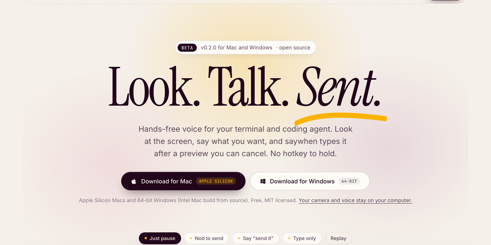
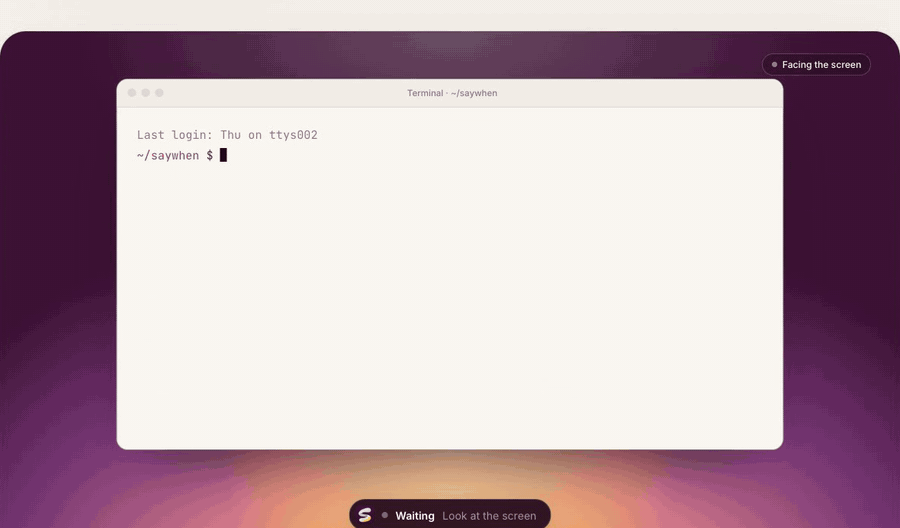
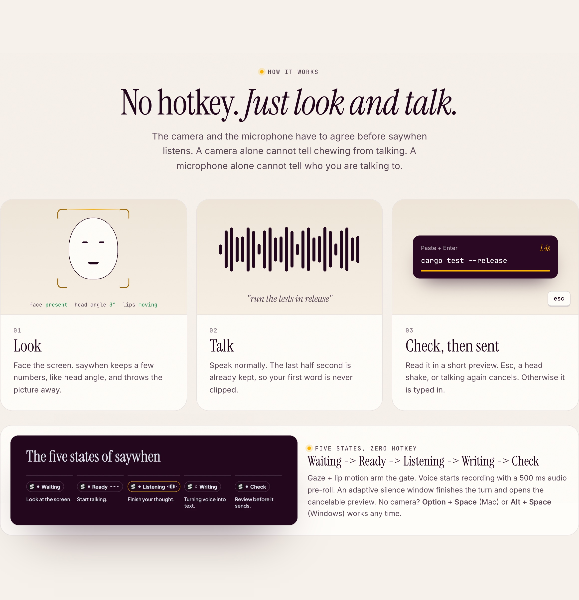
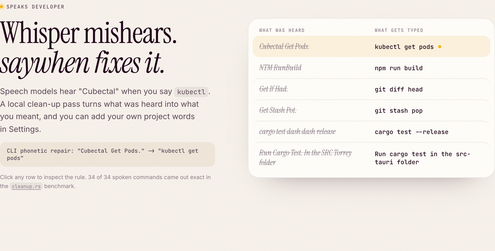
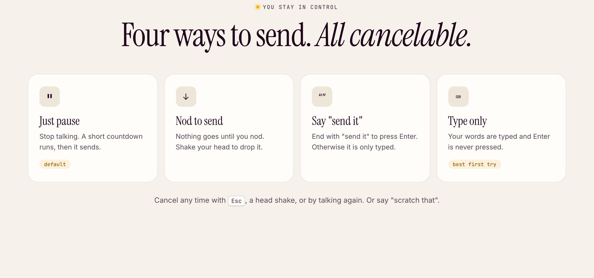
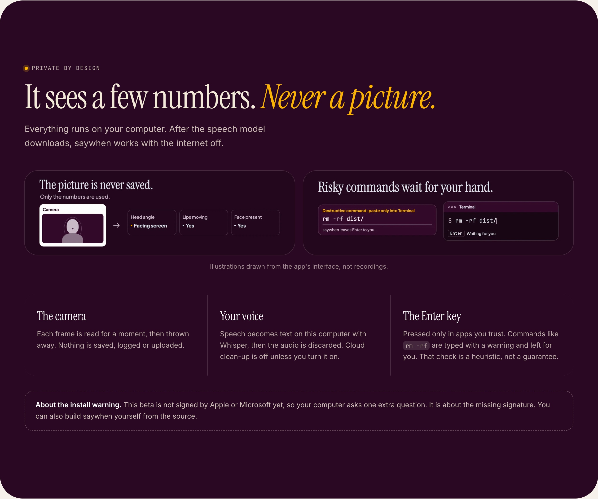
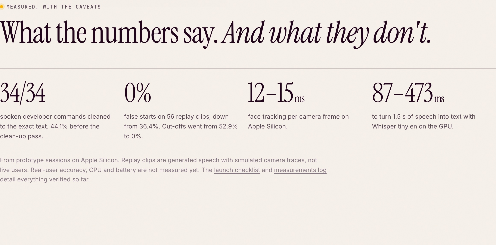

<p align="center">
  <a href="https://ansarbuilds.dev/p/saywhen/"></a>
</p>

<p align="center">
  <a href="https://github.com/ansarbuilds/saywhen/releases/download/v0.2.0/saywhen_0.2.0_aarch64.dmg"></a>
  &nbsp;
  <a href="https://github.com/ansarbuilds/saywhen/releases/download/v0.2.0/saywhen_0.2.0_x64-setup.exe"></a>
</p>

<p align="center">
  <a href="LICENSE"></a>
  <a href="https://github.com/ansarbuilds/saywhen/releases/tag/v0.2.0"></a>
  <a href="https://github.com/ansarbuilds/saywhen/actions/workflows/ci.yml"></a>
</p>

<p align="center">
  <a href="#how-it-works">How it works</a> ·
  <a href="#the-real-thing">See it for real</a> ·
  <a href="#private-by-design">Privacy</a> ·
  <a href="#install">Install</a> ·
  <a href="https://ansarbuilds.dev/p/saywhen/">Project page</a>
</p>

<p align="center">
  
</p>
<p align="center"><sub>A live illustration of the interface. The real, unedited recording is <a href="#the-real-thing">further down</a>.</sub></p>

<br>

## How it works



The camera and the microphone both have to agree before saywhen listens. A camera alone cannot tell chewing from talking, and a microphone alone cannot tell who you are talking to. No camera? **Option + Space** on Mac or **Alt + Space** on Windows starts listening by hand. More in [How saywhen works](docs/HOW_IT_WORKS.md).

## Speaks developer



Every row is a real case from the test suite in [`cleanup.rs`](src-tauri/src/cleanup.rs). Add your own words for project names in Settings.

## The real thing


Unedited and in real time: a spoken request goes into Cursor and gets sent with no keys pressed. One run on an Apple Silicon Mac, not a benchmark.

**The 60-second film, with sound:**

https://github.com/user-attachments/assets/2ac61c5f-9fce-4fb5-b146-e4e08f66a520

## You stay in control



- Cancel with **Esc**, a head shake, or by talking again during the countdown. Or say "scratch that".
- Enter is pressed only in apps you trust. Terminals and code editors are trusted by default. In chat, email and browsers, saywhen only types.
- If the app in front changes during the countdown, saywhen stops and types nothing.

## Private by design



After the speech model downloads, saywhen works with the internet off. History keeps the last 7 days of text on your computer, and you can turn it off or clear it. Optional cloud clean-up stays off until you turn it on. The risky-command check is a heuristic, not a guarantee.

## Measured, with the caveats



Replay clips are generated speech with simulated camera traces, not live users. Real-user accuracy, CPU and battery are not measured yet. Details in [what has been measured](docs/MEASUREMENTS.md) and the [launch checklist](docs/LAUNCH_CHECKLIST.md).

## Install

### Point Claude or Cursor at this repo

Open this folder and paste:

```text
Set up saywhen on my computer.

This repository is already open. Follow INSTALL_WITH_AI.md from the top.
Do not clone it again.
Ask me before you install anything. Explain each step in one plain sentence.
On a Mac, do not start the app yourself. Tell me the command to run in the Terminal app.
When the window is open, walk me through First launch in the README, one step at a time.
```

You only have the link? Paste this instead:

```text
Clone https://github.com/ansarbuilds/saywhen and open that folder.
Then follow INSTALL_WITH_AI.md from the top.
Ask me before you install anything. Explain each step in one plain sentence.
On a Mac, do not start the app yourself. Tell me the command to run in the Terminal app.
```

The full checklist is [INSTALL_WITH_AI.md](INSTALL_WITH_AI.md).

### Download the app

Get the beta installer from the **[v0.2.0 release](https://github.com/ansarbuilds/saywhen/releases/tag/v0.2.0)**:

- **Mac:** the `.dmg` file (`aarch64` is Apple Silicon, `x64` is Intel when that build is included). Drag saywhen into Applications.
- **Windows:** the `-setup.exe` file.

If your Mac says saywhen "is damaged" or "cannot be opened", this beta is not signed by Apple yet. Run this once, then open the app again:

```bash
xattr -cr /Applications/saywhen.app
```

On Windows, SmartScreen appears for the same reason. Click **More info**, then **Run anyway**.

### Build it yourself

You need Node.js 20 or newer, Rust, and CMake. On Windows, also install Visual Studio Build Tools 2022 with the "Desktop development with C++" workload.

```bash
git clone https://github.com/ansarbuilds/saywhen.git
cd saywhen
npm ci
npx tauri dev
```

The first run downloads the camera model (about 4 MB) and can take 5 to 15 minutes to compile. On a Mac, run that last command in the **Terminal** app. A background shell usually cannot get camera permission. The development app is named **saywhen-dev**.

### First launch

1. **Download a speech model.** Settings, then Speech model, then Download. Tiny is about 75 MB and the fastest. Base is more accurate.
2. **Allow the microphone and camera** when your computer asks.
3. **Allow Accessibility (Mac only).** Setup guide in the sidebar, then the orange badge. Turn on **saywhen**, or **saywhen-dev** if you built it. Remove old saywhen entries first if macOS is confused.
4. **Pick Type only** on Home for a first try, so Enter is never pressed.
5. **Turn on the camera.** Look at the screen with your mouth closed and click **Calibrate**.
6. Open a terminal, look at it, and say "git status".

## Beta, honestly

saywhen runs on an Apple Silicon Mac, and automated tests pass on macOS and Windows. The installers are not signed yet, and hands-on checks on Windows hardware and Intel Macs are still open. Something not working? See [when something goes wrong](docs/TROUBLESHOOTING.md), the [FAQ](docs/FAQ.md), or [open an issue](https://github.com/ansarbuilds/saywhen/issues/new/choose).

## For coding assistants

A person opened this repository in Claude, Cursor, or a similar tool. Read this before you install, run, or change anything.

**They want it running.** Follow [INSTALL_WITH_AI.md](INSTALL_WITH_AI.md) from the top. That file is the procedure. Do not invent a shorter one.

- If you can read this file, the code is already here. Do not clone a second copy. Run commands from this folder.
- Ask before installing anything system-wide: Homebrew, Rust, Node.js, CMake, or Visual Studio Build Tools. Say what it is, why saywhen needs it, and roughly how big it is.
- Explain each step in one plain sentence before you run it. Say "the tool that builds the app" rather than "the Rust toolchain".
- Never type their password. If a prompt will appear, tell them and wait.
- If a step fails, stop. Show the last few lines of the error. Do not skip it.
- Do not change System Settings yourself. Tell them which switch to click.
- On a Mac, do not run `npx tauri dev` from your own background shell. macOS gives the camera and microphone to the program that started saywhen, and a background shell is usually blocked (`NotAllowedError`). Ask them to open the **Terminal** app and run the command there. The dev app is named **saywhen-dev**.
- When the window opens, walk them through [First launch](#first-launch), one step at a time, and wait for each answer.
- You are done when a speech model is downloaded, the camera and microphone are allowed, and a short phrase such as "git status" shows up in a terminal they chose.

**They want you to change the code.** Read [AGENTS.md](AGENTS.md) (same guidance as [CLAUDE.md](CLAUDE.md)), [docs/ARCHITECTURE.md](docs/ARCHITECTURE.md), and [docs/ROADMAP.md](docs/ROADMAP.md) first. Keep the app local-first and private. Every automatic send must stay cancelable. If the camera, microphone, model, or typing fails, say so. Claims about speed or accuracy need a measurement. Do not commit model files (`*.bin`, `*.gguf`, `*.onnx`), recordings, or `settings.local.json`.

**They want to understand it.** Explain [How it works](docs/HOW_IT_WORKS.md) in plain language. The longer version is [docs/HOW_IT_WORKS.md](docs/HOW_IT_WORKS.md).

## For developers

saywhen is a [Tauri v2](https://tauri.app) app. Rust runs the engine. TypeScript draws the window.

```bash
npm run build
cargo test --locked --manifest-path src-tauri/Cargo.toml
```

| Path | What it is |
| --- | --- |
| [src-tauri/src/audio.rs](src-tauri/src/audio.rs) | Microphone, 500 ms pre-roll, voice detection, the 5-state machine, settings |
| [src-tauri/src/turn_taking.rs](src-tauri/src/turn_taking.rs) | When to start, when you are done, send modes, speech-cancel |
| [src-tauri/src/transcribe.rs](src-tauri/src/transcribe.rs) | Whisper on the GPU, model download, "send it" detection |
| [src-tauri/src/cleanup.rs](src-tauri/src/cleanup.rs) | Developer word clean-up, "scratch that", custom words, risky-command guard |
| [src-tauri/src/inject.rs](src-tauri/src/inject.rs) | Typing into other apps, per-app rules, front-app detection |
| [src/main.ts](src/main.ts) | Camera, head gestures, main window |

**[How it works](docs/HOW_IT_WORKS.md)** · **[How we built it](docs/HOW_WE_BUILT_IT.md)** · **[Architecture](docs/ARCHITECTURE.md)** · **[Measurements](docs/MEASUREMENTS.md)** · **[Roadmap](docs/ROADMAP.md)** · **[Contributing](CONTRIBUTING.md)** · **[Code of Conduct](CODE_OF_CONDUCT.md)** · **[Security](SECURITY.md)**
