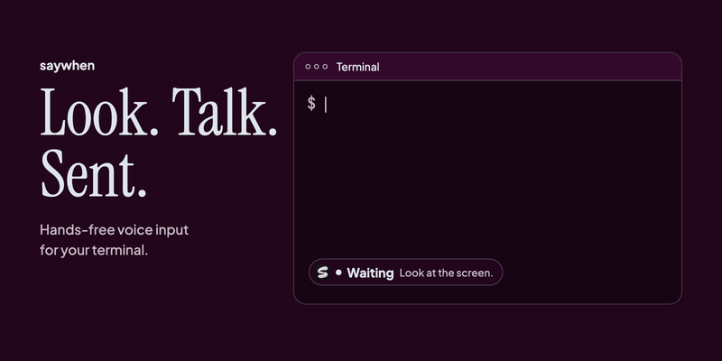
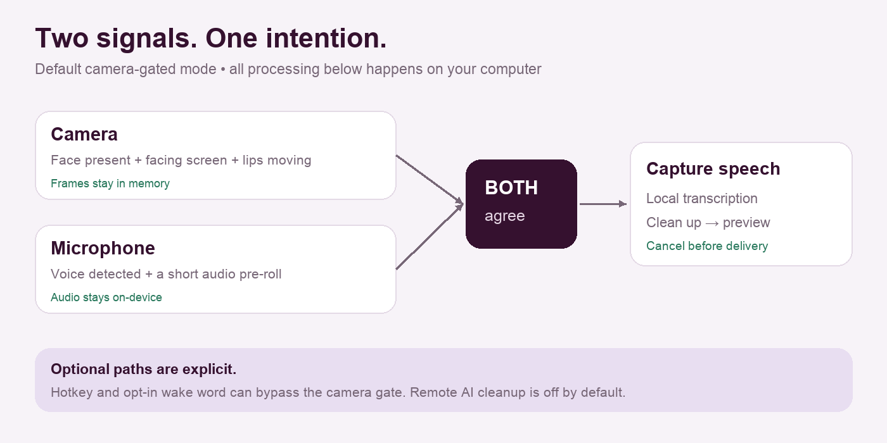

# Explore saywhen

Start with what you want to do. The user guides explain the app in plain language; the engineering documents go deeper into how it is built.

**[Watch the demo film with sound](https://ansarbuilds.dev/p/saywhen/)** · [Play it in the README](../README.md#watch-the-demo) · [Download the MP4](https://github.com/kmsmohamedansar/saywhen/releases/download/v0.2.0/saywhen-demo.mp4)

## Try it

| I want to... | Read this |
| --- | --- |
| Install and try my first command | [Install and first launch](../README.md#install) |
| Point Claude or Cursor at this repo | [For coding assistants](../README.md#for-coding-assistants) |
| Have my coding assistant help me install | [Install with AI](../INSTALL_WITH_AI.md) |
| Understand the camera, microphone and preview | [How it works](HOW_IT_WORKS.md) |
| Check what has actually been verified | [Launch checklist](LAUNCH_CHECKLIST.md) |
| Report something that failed | [Open an issue](https://github.com/kmsmohamedansar/saywhen/issues/new/choose) |

## Understand the project

| Topic | Guide |
| --- | --- |
| Why hands-free voice input? | [Vision](VISION.md) |
| How the prototype became an app | [How we built it](HOW_WE_BUILT_IT.md) |
| Components, data flow and state transitions | [Architecture](ARCHITECTURE.md) |
| Implementation history and measurement details | [Roadmap](ROADMAP.md) |
| Failure modes and constraints | [Risks](RISKS.md) |
| Contributing code or documentation | [Contributing](../CONTRIBUTING.md) |
| Reporting a security or privacy concern | [Security](../SECURITY.md) |

## A quick visual tour

The picture describes the default camera-gated path. The hotkey and optional wake word provide alternatives. Read [How it works](HOW_IT_WORKS.md) for the full behavior.

## About the visuals

The diagrams and animation illustrate the workflow. They are not recordings or performance benchmarks. App screenshots use the application's browser demo mode. Every illustrated concept also has a written explanation, and the animated walkthrough has a [static alternative](visuals/workflow-still.png).

See [visual asset notes](visuals/README.md) to regenerate them.
